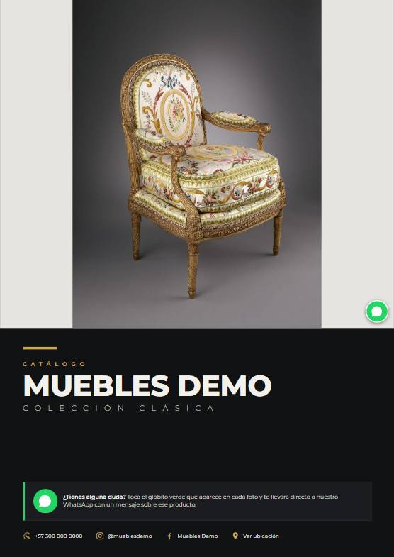
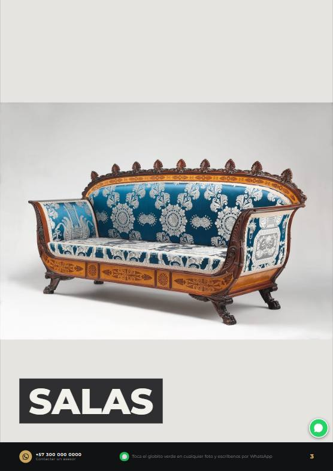
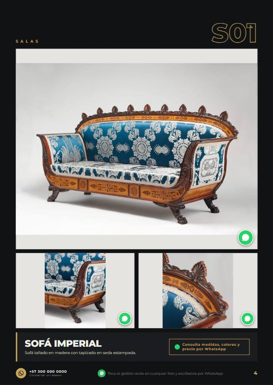
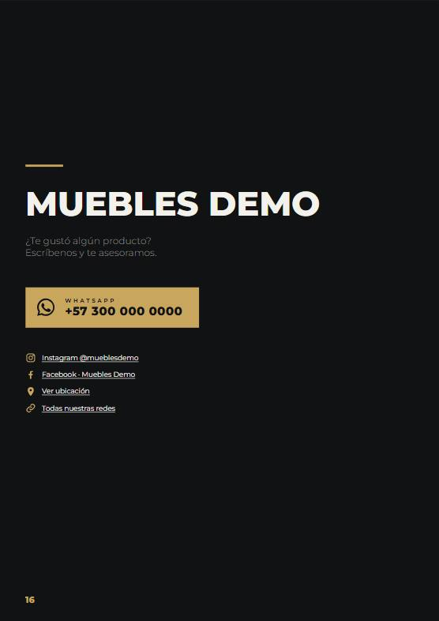

# WhatsApp Catalog Generator

Generate print-ready **PDF product catalogs where every photo is a WhatsApp button**: tapping a product opens a chat with the seller and a pre-filled message naming that exact product.

Built for small furniture stores in Colombia that sell through WhatsApp and Instagram. It has been used to deliver real catalogs to several clients; this repository contains the generator with a fictional brand ("Muebles Demo") and public-domain demo photos.

**[Download the sample PDF](https://github.com/cuajada69/whatsapp-catalog-generator/releases/download/v1.0.0/muebles-demo-catalog.pdf)** and tap any photo to try the WhatsApp links.

<p align="center">
  
  
  
  
</p>

## Features

- **One JSON file drives everything**: brand, WhatsApp number, socials, sections, products, photos and all visible texts (so the catalog can be in any language).
- **Clickable PDF**: every photo, footer and call-to-action links to `api.whatsapp.com/send` with a per-product message; the table of contents links to each page.
- **Automatic verification** after rendering: all images loaded, every image is a WhatsApp link, no page overflows, and the set of links inside the PDF matches the expected set exactly (nothing missing, nothing extra).
- **Same HTML, two outputs**: A4 pages for the PDF, and a single-column layout when the HTML is opened on a phone.
- Photos are resized and compressed with `sharp`, and are **never cropped** (a client requirement: the whole product must be visible).
- Config validation with clear errors (missing photos, duplicate product codes, malformed phone numbers).

## Quick start

Requires Node.js 20+ and Chrome, Edge or Chromium installed.

```bash
npm install
npm run catalog        # builds dist/catalog.html and renders + verifies dist/catalog.pdf
npm test               # unit tests (node:test)
```

If the browser is not auto-detected, set `BROWSER_PATH` to its executable.

## Configuration

`catalog.json` (abridged):

```json
{
  "brand": "Muebles Demo",
  "whatsapp": "573000000000",
  "whatsappDisplay": "+57 300 000 0000",
  "message": "Hola, vi el producto {name} ({code}) en el catálogo y quisiera más información.",
  "minPhotos": 3,
  "cover": "sillon-versalles-1",
  "sections": [
    {
      "name": "Salas",
      "cover": "sofa-imperial-1",
      "products": [
        { "code": "S01", "name": "Sofá Imperial", "photos": ["sofa-imperial-1", "sofa-imperial-2", "sofa-imperial-3"] }
      ]
    }
  ],
  "texts": { "cta": "Consulta medidas, colores y precio por WhatsApp", "...": "..." }
}
```

- Photos are looked up as `photos/<id>.jpg`.
- `message` supports `{name}`, `{code}` and any other product field.
- A section with a `cover` photo gets a full-page divider; without it, products follow directly.
- Products with fewer than `minPhotos` photos are skipped, so no page ends up with a lonely photo.

## How it works

```
catalog.json ──► src/build.mjs ──► dist/catalog.html + img/ + fonts/ + links.json
                     │  validateConfig, planPages (src/lib.mjs)
                     ▼
               src/pdf.mjs ──► dist/catalog.pdf
                     │  Puppeteer prints the HTML (CSS @page A4)
                     └─ pdf.js reads the PDF back and checks its link annotations against links.json
```

- `src/lib.mjs`: pure functions (link building, template filling, validation, page planning), all unit tested.
- `src/build.mjs`: renders the HTML from small template functions and prepares assets.
- `src/pdf.mjs`: prints to PDF and verifies the output; `--screenshots` saves page previews to `docs/`.

### Design decisions

- **`api.whatsapp.com/send` instead of `wa.me`**: during testing with real clients, `wa.me` and `whatsapp://` links failed in some mobile PDF viewers.
- **HTML + CSS print instead of a PDF library**: layout, fonts and responsive behavior come for free, and the same file doubles as a mobile web catalog.
- **Verify the PDF, not just the HTML**: Chromium can silently drop links (e.g. on overlapping elements), so the final PDF is parsed and its links compared with what was generated.

## Credits

Demo photos: The Metropolitan Museum of Art Open Access collection via Wikimedia Commons, CC0. See [photos/CREDITS.md](photos/CREDITS.md).

## License

MIT
